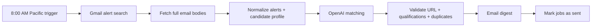

# AI Job Hunter | n8n Portfolio Edition

  

An **automation portfolio project** that reads opted-in LinkedIn, Handshake and Indeed job-alert emails, compares postings against a documented candidate profile, and emails a short California internship / junior-role digest. Built using **n8n, JavaScript, Gmail, and the OpenAI Chat Completions API**.

> **Project status:** Source and offline JavaScript tests are included. The real integration has **not been connected or executed** with your Gmail/OpenAI credentials in this repository. Import, connect and verify it in your n8n account before describing it as deployed. The app does not apply for jobs automatically.

## Architecture



## What's included

| File | Purpose |
| --- | --- |
| `workflows/jarvis-job-hunter.json` | Importable production workflow, disabled until configured |
| `workflows/jarvis-offline-demo.json` | Safe two-node demo without API, Gmail or real employers |
| `src/prepare.js` | Parse Gmail MIME bodies, build verified candidate profile and limit prompt size |
| `src/digest.js` | Validate model output, reject untrusted URLs, estimate fit, format notification |
| `src/mark-sent.js` | Save previously emailed job keys **after Gmail send succeeds** |
| `tests/run-tests.cjs` | Node-based tests with mocked n8n runtime |
| `examples/sample-results.json` | Fictional demonstration data |

## Setup in n8n Cloud (10 steps)

1. Download / clone this repo and open **n8n > Workflows > New workflow > menu (⋯) > Import from File**.
2. Import `workflows/jarvis-job-hunter.json`. Do **not** publish/activate yet.
3. Connect your own **Gmail OAuth credential** in the nodes **Find Job Alert Emails**, **Fetch Full Email Content** and **Email Daily Digest**. Gmail access must be permitted by your account administrator if using school/work email.
4. Open **Prepare Candidate and Alerts** and set `recipient` to the mailbox where you want the digest. Keep your actual email **only in your private n8n instance**, not in your public GitHub JSON.
5. Verify every fact in `profile` and edit to reflect **your true skills and graduation status**. The included candidate profile is a sanitized example based on verified background; it deliberately does not claim Python, Power BI, Power Automate, or a completed CS degree.
6. Create an **OpenAI API credential** in n8n and select it under **AI Evaluate Jobs**. This is API billing, separate from ChatGPT subscriptions. The HTTP node uses `gpt-4o-mini` with JSON mode; switch models only after checking model availability and compatible parameters.
7. Confirm Gmail alerts are arriving. The Gmail query currently searches only the last **two days**. The **Get Many** node retrieves at most 35 messages, the second Gmail node fetches the full body for each, and the code caps prompt content and URLs.
8. Import `workflows/jarvis-offline-demo.json` separately, execute its **Manual Test Trigger**, and confirm it returns two **fictional** jobs with scores and no errors. This verifies the basic workflow UI, not the Gmail/OpenAI integration.
9. Back in the real workflow, use **Execute workflow** once. Inspect outputs in every node, verify a digest arrives, and check that URL links lead to actual job pages. If the Gmail search yields zero messages, send yourself a test alert or widen `newer_than:2d` temporarily. **Beware: manual runs may send a real email.**
10. When everything works, **publish / activate** the workflow and verify one scheduled 8 AM Pacific run. Re-run only after inspecting results to avoid extra API costs or notifications.

## Safety and data handling

- **No stored secrets.** Exported workflows do not include credentials, OAuth tokens, API keys, personal addresses or resume files.
- **No fabricated application links.** AI suggestions are only accepted if their URL exactly occurs in the Gmail source email URL allowlist.
- **No false resume claims.** Technical skills that haven't been confirmed remain in `unverifiedSkills` and cannot be presented as existing experience.
- **Limited data sharing.** The workflow sends bounded email content and the candidate profile to an AI API. Do not put private student records, personal addresses, medical information or other sensitive records into source alerts or profile fields.
- **No LinkedIn or Handshake scraping.** It reads job alert emails you already receive; no automated site logins or applications.
- **No automatic hiring decisions.** Scores are approximate relevance, not chance of being hired. Verify qualification, deadlines, compensation, employer authenticity and job availability yourself.
- **Untrusted content protection.** The system prompt asks the model to ignore instructions in email bodies; output URL allowlisting provides an additional code-level check.

## Failure handling and limitations

- Gmail reading and AI HTTP nodes use **continue on failure**. Failed requests and malformed JSON produce a diagnostic email when the outgoing Gmail connection is available. Sending itself must succeed for the delivery to be counted.
- The duplicate store uses n8n `$getWorkflowStaticData('global')`. n8n documents that this **doesn't persist in manual test executions**; it is saved only for successful published-trigger executions. For production workloads or shared multi-user deployments, replace it with n8n **Data Tables** or a database.
- Duplicate detection is per `(company, title, exact URL)` for 45 days. Different tracking URLs for the same listing may still result in repeats; manually inspect the digest.
- Redirect / tracking links found in email are not followed or verified by this project. Some alert emails contain links to tracking intermediaries; opening them requires your own judgment.
- Gmail formatting differs across senders. The MIME extraction helper handles common plain-text and HTML payloads but may need tweaks for unusual messages or link wrappers.
- The automated tests mock n8n's runtime. They **do not** test OAuth, Gmail API responses, OpenAI billing, or actual cloud deployment.
- This edition sends a plain-text digest; it does not save a spreadsheet, create a full Word resume, or submit applications. An initial empty digest is expected if there are no qualifying alerts.

## Tests

Install **Node.js 20+**, then run from the project root:

```bash
npm test
```

Tests cover MIME parsing, candidate skill hygiene, trusted link enforcement, senior-role rejection, within-run duplicates, saved sent-history behavior, error-message handling, demo data and n8n graph structure.

## How this maps to program operations / analyst internships

- **Workflow optimization:** timer-based alert intake, validation and conditional reporting.
- **Reporting and tracking:** score summaries and duplicate-control mechanism.
- **Business process documentation:** diagrams, setup and failure notes in this README.
- **Responsible AI integration:** bounded prompts, verified qualifications and link validation.
- **Next learning step:** remake the job digest using **Power Automate** and a **Power BI** report to demonstrate Microsoft-specific skills. Those integrations are **not yet implemented**.

## Future enhancements

1. Replace static state with n8n Data Tables and stable job IDs.
2. Add source-specific HTML parsing and employer careers-page verification.
3. Add a Microsoft 365 version with Power Automate, Excel tables, Power BI.
4. Create human-reviewed resume tailoring with a document export.
5. Build a TypeScript/React front end and shared, authenticated storage.

## Attribution

This is an independently designed educational portfolio project. It is **not affiliated with LinkedIn, Handshake, Indeed, OpenAI, n8n, or any employer**.

MIT License. See `LICENSE`.
